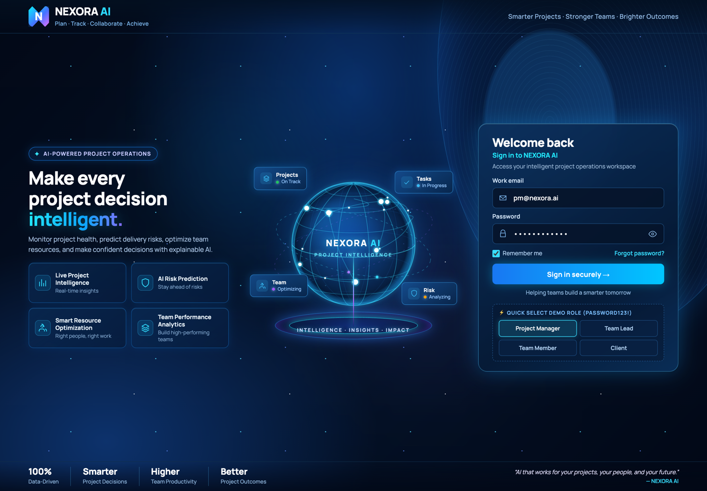
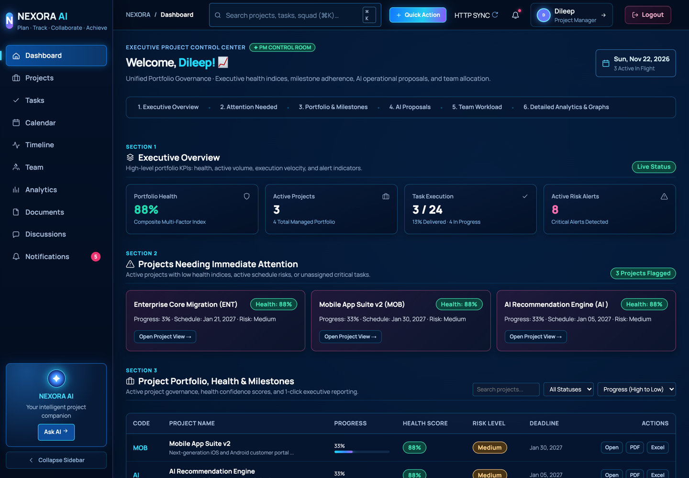
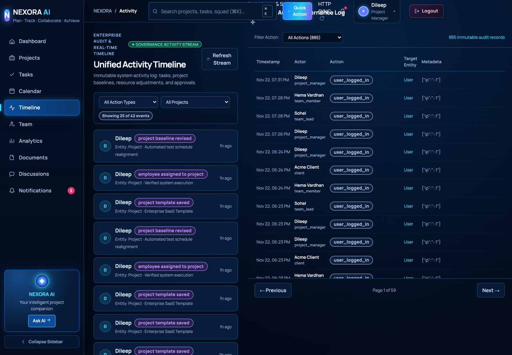
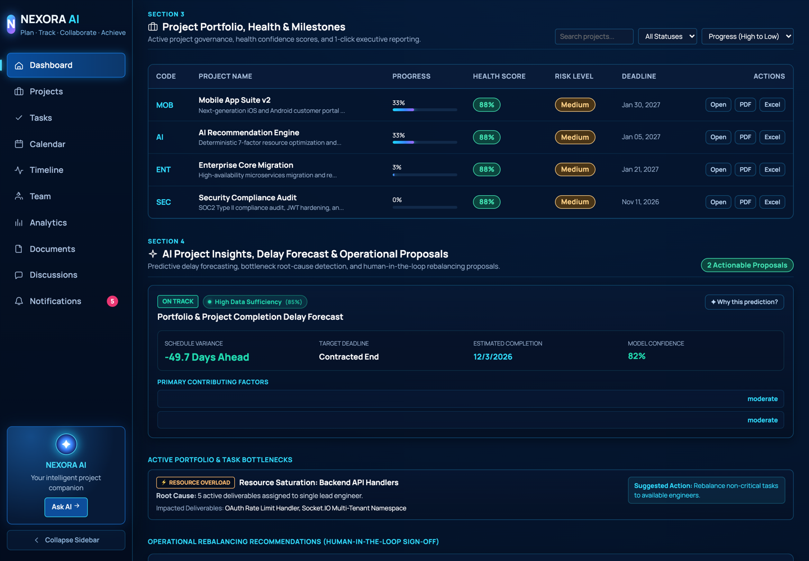
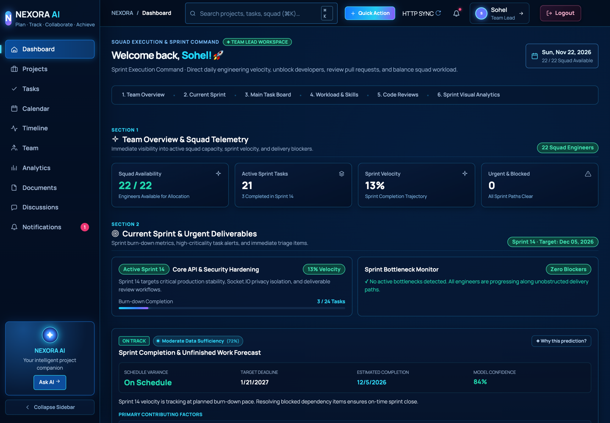
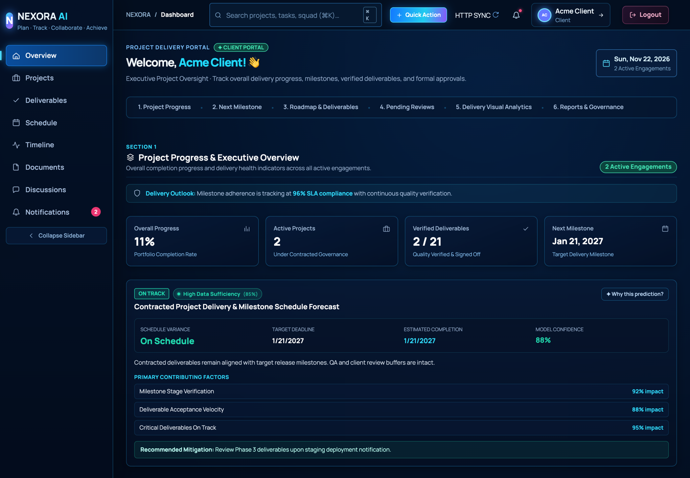
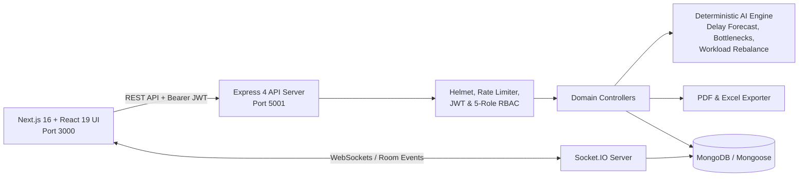

# NEXORA AI — Intelligent Project Management & Analytics SaaS

A full-stack, real-time Project Management SaaS platform built with **Next.js 16**, **React 19**, **Node.js**, **Express 4**, **Socket.IO**, and **MongoDB**, featuring 5-role Role-Based Access Control (RBAC), Gantt & critical path tracking, deterministic AI delay forecasting, and human-in-the-loop workload rebalancing.


---

## Overview

NEXORA AI turns live project, task, milestone, dependency, and contributor capacity data into actionable intelligence across role-scoped workspaces. Managers and team leads receive explainable schedule-delay predictions, bottleneck alerts, and ranked resource reassignment recommendations—while preserving strict backend confidentiality for client-facing portals.

## Problem Statement

Modern software teams juggle fragmented task boards, spreadsheets, and chat tools without unified visibility into critical-path dependencies, developer burnout, or schedule risk. Meanwhile, external clients need transparent milestone reporting without exposing internal staff workload or private operational discussions. NEXORA AI unifies execution tracking, real-time collaboration, explainable risk analytics, and strict role-based privacy in one platform.

## Key Features

- **5-Role RBAC & Backend Confidentiality Firewall:** Dedicated access boundaries enforced in Express middleware and controllers for **Project Manager**, **Team Lead**, **Team Member**, **Client** (internal developer names, private discussions, and staff allocations masked at the API layer), and **Administrator**.
- **Deterministic AI Intelligence & Recommendation Engine:**
  - Predictive task/project delay forecasting with explainable contributing factors.
  - Bottleneck detection and capacity-aware workload rebalancing recommendations.
  - Human-in-the-loop approval and dismissal workflow with full audit logging.
- **Interactive Project Planning & Gantt Timeline:** Task dependencies, critical-path highlighting, circular dependency prevention, milestone tracking, and smart calendar views.
- **Real-Time Collaboration (Socket.IO):** Room-isolated project updates, live discussions, notifications, and document repository management with version history.
- **Employee & Capacity Management:** Skill-searchable employee directory, availability tracking, project assignment management, and deactivation/reassignment flows.
- **Executive Analytics & Exports:** Portfolio health metrics, sprint velocity/burnup analytics, and **PDF (`pdfkit`) / Excel (`exceljs`)** report generation.
- **Security Hardening:** JWT authentication, `bcryptjs` password hashing, `helmet` security headers, rate limiting (`express-rate-limit`) on auth/registration endpoints, and session governance.

## Screenshots

### Authentication & Role-Scoped Project Manager Command Center
| Login Portal | Project Manager Dashboard |
| :---: | :---: |
|  |  |

### Critical Path Gantt & AI Delay Forecasting
| Gantt & Critical Path | AI Delay Forecast & Recommendations |
| :---: | :---: |
|  |  |

### Team Lead & Client Confidentiality Views
| Team Lead Dashboard | Client Dashboard (Confidentiality-Filtered) |
| :---: | :---: |
|  |  |

## Technology Stack

| Layer | Technologies |
| :--- | :--- |
| **Frontend** | Next.js 16 (App Router), React 19, Socket.IO Client, Custom CSS Design System |
| **Backend** | Node.js 20+, Express 4, Socket.IO 4, Mongoose 8, JWT, `bcryptjs`, Helmet, Express Rate Limit |
| **Database** | MongoDB |
| **Reporting & Quality** | `pdfkit`, `exceljs`, Node Test Runner (`node --test`), ESLint 9 |

## Architecture



## Project Structure

```text
nexora-ai/
├── app/                              # Next.js 16 App Router pages, dashboards & styles
├── components/                       # Reusable analytics and chart components
├── lib/                              # API client, normalization, intelligence & Socket.IO helpers
├── docs/screenshots/                 # Verified application screenshots
├── projectpulse-ai/
│   └── backend/
│       ├── scripts/                  # Seed, demo setup, and DB inspection scripts
│       ├── src/
│       │   ├── config/               # Database configuration
│       │   ├── controllers/          # REST controllers
│       │   ├── middleware/           # Auth, RBAC, and error handling
│       │   ├── models/               # Mongoose domain models
│       │   ├── routes/               # /api/v1 endpoints
│       │   └── services/             # Metrics, AI forecasting, analytics, reporting, realtime
│       └── tests/                    # 15 automated API, RBAC, realtime, and AI test suites
├── start.sh                          # Local full-stack launcher
├── stop.sh                           # Local process stop script
└── package.json                      # Root scripts for frontend & backend orchestration
```

## Core API Endpoints (`/api/v1`)

| Group | Example Endpoints |
| :--- | :--- |
| **Health & Auth** | `GET /health`, `POST /auth/register`, `POST /auth/login`, `POST /auth/logout`, `GET /auth/me` |
| **Projects & Tasks** | `GET/POST /projects`, `GET/PATCH/DELETE /projects/:projectId`, `GET/POST /tasks`, `PATCH /tasks/:taskId/progress`, `PATCH /tasks/:taskId/assign` |
| **Dashboards & Analytics** | `GET /dashboard/:role`, `GET /projects/:projectId/workload`, `GET /projects/:projectId/analytics`, `GET /analytics/sprint-intelligence/:projectId`, `GET /analytics/client-intelligence/:projectId` |
| **AI Intelligence** | `GET /ai/predictive-delays/:projectId`, `GET /ai/workload-rebalance/:projectId`, `GET /ai/project-delay/:projectId`, `POST /tasks/:taskId/recommend-replacement`, `POST /tasks/:taskId/reassign` |
| **Employees & Collaboration** | `GET/POST /employees`, `POST /employees/:employeeId/deactivate`, `GET /search`, `GET /calendar`, `GET /notifications` |

## Installation & Execution

### Prerequisites
- Node.js 20+ and npm
- Running MongoDB instance (`mongodb://127.0.0.1:27017` or MongoDB Atlas)

### 1. Clone and configure environment files
```bash
git clone https://github.com/Dileep-4321/nexora-ai.git
cd nexora-ai
cp .env.example .env.local
cp projectpulse-ai/backend/.env.example projectpulse-ai/backend/.env
```
Update `JWT_SECRET` and `MONGODB_URI` in `projectpulse-ai/backend/.env`. Never commit `.env` or `.env.local`.

### 2. Install dependencies
```bash
npm install
npm install --prefix projectpulse-ai/backend
```

### 3. Seed demo data
```bash
npm run seed:demo
```

### 4. Start frontend and backend
Option A — Run in separate terminals:
```bash
# Terminal 1: Backend API + Socket.IO (Port 5001)
npm run dev --prefix projectpulse-ai/backend

# Terminal 2: Next.js Frontend (Port 3000)
npm run dev
```
Option B — Build & launch via helper scripts (macOS/Linux):
```bash
npm run build
./start.sh
# Stop services:
./stop.sh
```

Open [http://localhost:3000](http://localhost:3000). Health endpoint: [http://localhost:5001/api/v1/health](http://localhost:5001/api/v1/health).

### Seeded Local Demo Accounts
*(For local seeded development environments only — default seed password: `Password123!`)*

| Role | Email |
| :--- | :--- |
| Project Manager | `dileep@nexora.ai` (or `pm@nexora.ai`) |
| Team Lead | `sohel@nexora.ai` (or `lead@nexora.ai`) |
| Team Member | `hema@nexora.ai` (or `member@nexora.ai`) |
| Client | `client@nexora.ai` |
| Administrator | `admin@nexora.ai` |

## Automated Testing & CI

The backend includes **15 automated Node test suites** (**15 / 15 suites passing — 148 passed, 0 failed**) covering RBAC, client confidentiality firewall, Socket.IO room isolation, Gantt/timeline calculations, analytics, security hardening, and AI forecasting, automatically verified in GitHub Actions alongside frontend ESLint and Next.js production builds:

```bash
# Run individual suite against seeded MongoDB:
cd projectpulse-ai/backend
node --test --test-force-exit tests/metrics.test.js
node --test --test-force-exit tests/client-security-audit.test.js
node --test --test-force-exit tests/realtime.test.js
```

> **Note:** Three integration suites (`balanced-master-upgrade.test.js`, `employee-management.test.js`, `master-enterprise-upgrade.test.js`) send HTTP requests to `http://localhost:5001` and require the backend server to be running locally.

## Future Enhancements

- Add CI workflow (GitHub Actions) with an ephemeral MongoDB service container.
- Add refresh-token rotation and optional OAuth/SSO providers.
- Containerize frontend, backend, and MongoDB with Docker Compose for single-command deployment.
- Plug in trained historical ML models behind the deterministic risk-forecasting service interface.

## Contributing

1. Fork the repository and create a branch (`git checkout -b feature/your-feature`).
2. Keep changes modular, lint clean, and run backend test suites before submitting a Pull Request.
3. Never commit `.env` files, database dumps, or personal credentials.

## License

This project is licensed under the [MIT License](LICENSE).
